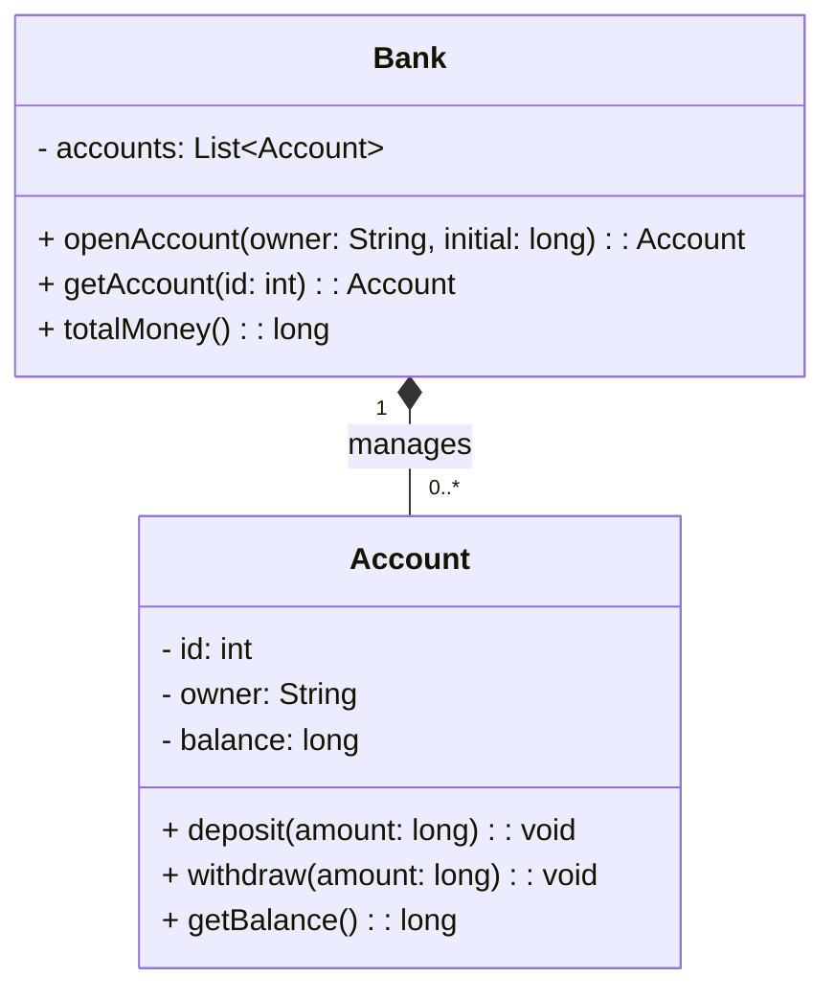

# Lab 3 — ConcurrentBank 🏦

A small banking system that starts out single-threaded and becomes concurrent one step at a time.
Each step adds **one** idea from *Lecture 3: Programmazione concorrente in Java*, so you can
**watch the bug happen** before you fix it.

> Lab rule: **break it first, then fix it.** For every step, write down in `NOTES.md` what you
> expected, what actually happened, and *why* (using the vocabulary from the notes: monitor,
> data race, happens-before, …).

---

## Goals

By the end of the core part you should be able to:

- create and start threads with `Runnable` / `Thread`, and explain `start()` vs `run()`
- wait for threads with `join()` and explain why it makes results visible
- reproduce a **race condition** and fix it with `synchronized`
- reproduce a **deadlock**, diagnose it with `jstack`, and fix it
- coordinate threads with `wait()` / `notifyAll()`
- explain every fix in terms of the **Java Memory Model** (happens-before, synchronization edges)

## Reference sections in the notes

| Step | Topic | Notes |
|------|-------|-------|
| 0 | Classes, UML, exceptions | §1.1, §1.2, §1.9 |
| 1 | `Thread`, `Runnable`, `start()` | §3.1 |
| 2 | Thread lifecycle, `join()` | §3.2, §3.2.1 |
| 3–4 | Race conditions, `synchronized` | §3.3, §3.4.3 |
| 5 | Deadlock | §3.3 |
| 6 | `wait()` / `notifyAll()` | §3.3 |
| 7 | Visibility, stopping threads | §3.4 |

---

## Suggested project structure

```
lab3/
├── README.md
├── NOTES.md                ← your observations and answers to the questions
└── src/
    └── bank/
        ├── Main.java
        ├── Account.java
        ├── Bank.java
        ├── Customer.java   (step 1)
        ├── Auditor.java    (step 5)
        └── ...
```

Compile and run without any build tool:

```bash
javac -d out $(find src -name "*.java")
java -cp out bank.Main
```

---

# Part 1 — Core (do these in order)

## Step 0 — The single-threaded bank

No threads yet. Build the domain model first.



**Tasks**
- [ ] Implement `Account` and `Bank` as shown in the UML.
- [ ] Use `long` cents for money, not `double`. (Why? Write it in `NOTES.md`.)
- [ ] `withdraw()` must refuse to go below zero. Throw an `InsufficientFundsException`.
      Decide whether it should be **checked** or **unchecked** (§1.9) and justify the choice.
- [ ] In `Main`, open 3 accounts, do a few operations and print the balances.

**Question:** the UML shows a *composition* between `Bank` and `Account`. Would *aggregation* make sense instead? (§1.2.2)

---

## Step 1 — First threads: independent customers

Each customer works on **their own** account, so nothing is shared yet.

**Tasks**
- [ ] Create `Customer implements Runnable`. Its constructor takes an `Account` and a number of operations.
      In `run()`, do N deposits of random amounts, sleeping `Thread.sleep(10)` between them.
- [ ] Print every operation together with `Thread.currentThread().getName()`.
- [ ] Give the threads readable names (`new Thread(runnable, "customer-Alice")`).
- [ ] In `Main`, start 3 customers with `start()`.
- [ ] Now replace `start()` with `run()`. What changes in the output and in the total time?

**Questions**
1. Why is implementing `Runnable` usually preferred over extending `Thread`? (§3.1)
2. Run the program 5 times. Is the order of the lines always the same? Why?

---

## Step 2 — Waiting for the customers: `join()`

**Tasks**
- [ ] After starting the customers, print the bank's total money **immediately**. Run it a few times.
- [ ] Now `join()` all customer threads first, then print the total.
- [ ] Add a "final report" that prints each account's balance after all customers are done.
- [ ] *(Mini-challenge)* Print `t.getState()` for a customer thread at different moments:
      before `start()`, while it sleeps, after `join()`. Compare with the lifecycle diagram in §3.2.

**Questions**
1. Why is the total wrong (or random) without `join()`?
2. The notes say: *"all actions of a thread happen-before another thread returns from `join()` on it"*.
   Explain how this guarantees that main sees the final balances.

---

## Step 3 — Shared account: the race condition 💥

Now a family shares one **joint account**.

**Tasks**
- [ ] Create one account with balance `0`.
- [ ] Start 4 `FamilyMember` threads on **the same** account. Each does 100,000 deposits of `1`.
      Remove the `sleep()` so the threads collide as much as possible.
- [ ] Print *expected* vs *actual* final balance.
- [ ] Run it 10 times and record the results in `NOTES.md`.
- [ ] Make it worse: half the members deposit `1` and half withdraw `1` (start from a big balance).
      Can the balance ever end up "impossible"?

**Questions**
1. `balance += amount` looks like one instruction. Split it into the separate actions that actually happen.
2. Describe one interleaving of two threads that loses a deposit.
3. Using the definition in §3.4.3: which two accesses form a **data race** here?

---

## Step 4 — Fixing it with `synchronized`

**Tasks**
- [ ] Fix `Account` with `synchronized` **methods**. Check the result is now always correct.
- [ ] Rewrite the fix using a `synchronized` **block** on a `private final Object lock`.
- [ ] Measure the time of the broken version and the fixed versions. Record the numbers.
- [ ] Does `getBalance()` also need to be synchronized? Try it without and think about **visibility**, not only atomicity.

**Questions**
1. Which **monitor** does a `synchronized` method lock? And a `static synchronized` method?
2. Why is locking a private object sometimes better than locking `this`?
3. Explain the fix with the rule: *"an unlock on a monitor happens-before every subsequent lock on the same monitor"*.

---

## Step 5 — Transfers and deadlock 🔒🔒

**Tasks**
- [ ] Add `Bank.transfer(fromId, toId, amount)`. Lock both accounts with nested `synchronized` blocks:
      first `from`, then `to`.
- [ ] Start two threads: one transfers A→B in a loop, the other B→A. Wait until it freezes.
- [ ] While it is frozen, open another terminal and run `jps` (find the PID), then `jstack <PID>`.
      Find the line `Found one Java-level deadlock` and copy the relevant part into `NOTES.md`.
- [ ] Fix it with **lock ordering**: always lock the account with the **smaller id** first.
- [ ] Add an `Auditor` thread that checks the invariant
      **"the total money in the bank never changes"** every few milliseconds while 8 threads make random transfers.

**Questions**
1. List the 4 conditions needed for a deadlock. Which one does lock ordering break?
2. If the auditor sums the balances **without** locking, it sometimes sees a wrong total, even though no money is lost. Why?
3. How can the auditor lock **all** accounts without creating a new deadlock?

---

## Step 6 — Waiting for money: `wait()` / `notifyAll()`

A withdrawal should **wait** until enough money is available instead of failing.

**Tasks**
- [ ] Add `Account.withdrawBlocking(amount)`. It waits while `balance < amount`.
      `deposit()` must wake the waiting threads up.
- [ ] Simulate it: one `Employer` thread deposits a salary every 200 ms, and two `Spender` threads
      try to withdraw random amounts. Log who waits and who gets woken up.
- [ ] Experiment 1: replace `while (balance < amount) wait();` with `if`. Find a scenario where it breaks.
- [ ] Experiment 2: replace `notifyAll()` with `notify()`. Can a thread wait forever even though there is enough money?

**Questions**
1. Why must `wait()` be called while holding the monitor? What happens otherwise? (Try it!)
2. What does `wait()` do to the monitor while the thread is waiting?
3. What is a *spurious wake-up*, and how does the `while` loop protect against it?

---

## Step 7 — Closing the bank: stopping threads correctly

**Tasks**
- [ ] Give the bank an "open" flag: `private boolean open = true;`. Customers loop
      `while (bank.isOpen()) { ... }`, and main calls `bank.close()` after 2 seconds.
- [ ] First write it **without** any synchronization and with an empty or very tight loop body.
      Does every customer stop? (Sometimes they don't. Find out why.)
- [ ] Fix it with `synchronized` `isOpen()` / `close()`.
- [ ] Customers blocked in `withdrawBlocking()` never re-check the flag. Use `thread.interrupt()` to
      wake them, and handle `InterruptedException` properly.

**Questions**
1. Nobody writes the flag concurrently, so why can a thread still read a stale value? (§3.4)
2. Why is catching `InterruptedException` and doing nothing a bad idea?

---

### ✅ Core part complete when

- [ ] All steps work, and the broken versions are kept (e.g. commented out or in `broken/` classes) for comparison
- [ ] `NOTES.md` answers every question
- [ ] The final simulation runs: N customers, random transfers, auditor, clean shutdown, invariant never violated

---

# Part 2 — Extensions (pick what you like)

These are outlines, not step-by-step instructions. Design them yourself, and draw the UML before coding.

### A. Design patterns from the course (Lecture 2)
- **Singleton** — make `Bank` a Singleton, then attack it with 100 threads calling `getInstance()` at the same moment.
  How many instances are created? Fix it, and compare *synchronized getInstance*, *eager init* and the *holder idiom*.
- **Factory** — `AccountFactory.create(type, ...)` for `CheckingAccount`, `SavingsAccount` (with interest),
  `BusinessAccount` (overdraft allowed). Use an abstract class or an interface?
- **Strategy** — pluggable `FeePolicy` (no fee, flat fee, percentage fee) applied to transfers.
- **Observer** — `TransactionListener`s notified on each operation (a logger, a "fraud detector" for big withdrawals).
  ⚠️ What happens if a listener is added *while* another thread is notifying? Make the subject thread-safe.
- **Decorator** — `AuditedAccount` wraps an `Account` and logs every call without changing it.

### B. Transaction history + Streams (Lecture 4)
- Record every operation as an immutable `Transaction` (id, type, from, to, amount, timestamp, thread name).
- The history list is shared by all threads: make it safe.
- Generate reports with the Stream API: total moved per account, top 3 richest accounts,
  all transfers above a threshold, number of operations per thread (`groupingBy`).

### C. Testing (Lecture 5)
- JUnit tests for `Account` and `Bank` in single-threaded scenarios.
- Draw the control-flow graph of `transfer()` and design tests for **statement**, **decision** and
  **condition** coverage (§5.1).
- Write a concurrency test for the joint account (Step 3). Run the broken version 1,000 times in a loop: how often does it pass?
  What does this say about coverage criteria vs concurrency bugs?

### D. More simulation
- An `InterestScheduler` thread that adds interest to all savings accounts every second. It must lock every account consistently.
- A `Bank` with limited **tellers**: build your own counting semaphore (`acquire`/`release` with `wait`/`notifyAll`)
  so that at most K customers are served at the same time.
- Bounded **request queue**: customers submit operations to a queue and "teller" threads execute them (producer–consumer).

### E. Performance experiments
- **Coarse-grained** locking (one lock for the whole bank) vs **fine-grained** locking (one lock per account):
  measure throughput with 1, 2, 4, 8, 16 threads and plot the results.
- How does the number of accounts change contention?

### F. Beyond the notes (when the course gets there)
- `ReentrantLock` + `tryLock(timeout)` as an alternative deadlock fix
- `AtomicLong` for counters, `ConcurrentHashMap` for the account registry
- `ExecutorService` instead of creating threads by hand, `CountDownLatch` to start all threads at once
- Virtual threads (Java 21+): try 10,000 customers

---

## Tips

- **Make bugs easy to see:** a `Thread.sleep(1)` between reading and writing the balance turns a rare race into one that happens every time.
- **Never trust a single run.** Concurrent bugs are nondeterministic, so repeat every experiment several times.
- **Use the tools:** `jps` + `jstack` for deadlocks; `jconsole` or VisualVM to watch threads live.
- **Commit after each step** so you can compare the broken and fixed versions with `git diff`.
